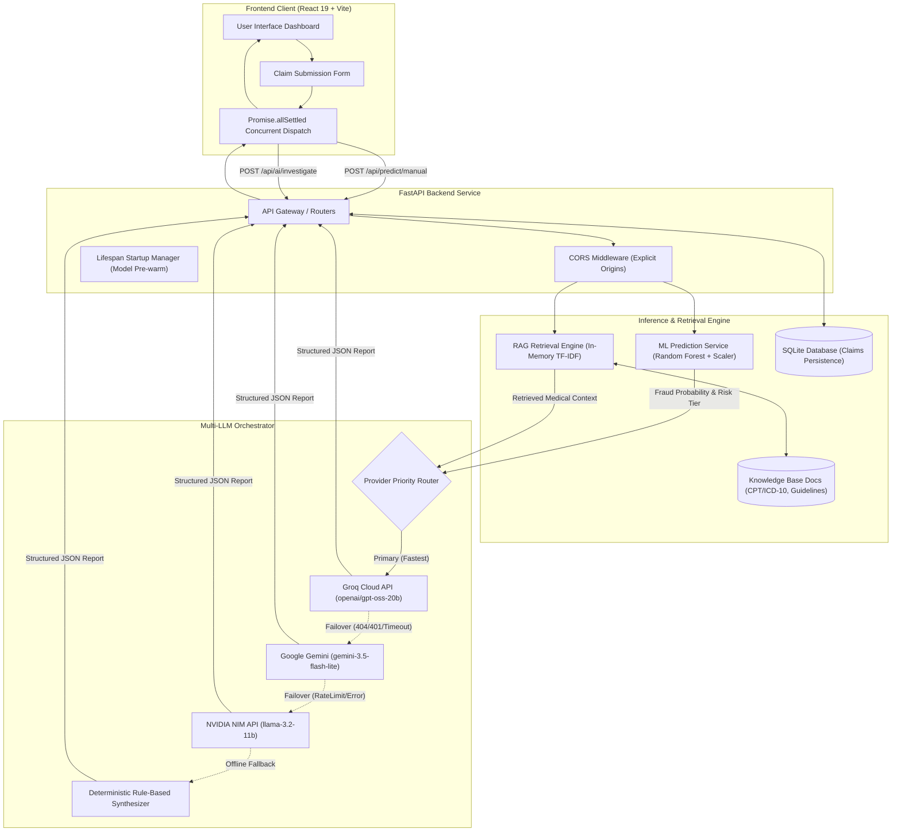

# Healthcare Insurance Claim Fraud Detection with RAG-Powered AI Investigation

[](https://www.python.org/)
[](https://fastapi.tiangolo.com)
[](https://react.dev/)
[](https://www.typescriptlang.org/)
[](https://vitejs.dev/)
[](https://scikit-learn.org/)
[](https://tailwindcss.com/)
[](#contribution-license-and-author)
[](backend/tests/)

An enterprise-grade, end-to-end healthcare claim fraud risk assessment and AI investigation platform. The system bridges quantitative machine learning fraud prediction with qualitative, evidence-backed clinical decision support by combining a **Scikit-Learn Random Forest Classifier**, an in-memory **Retrieval-Augmented Generation (RAG)** pipeline grounded in healthcare billing guidelines, and an automated **Multi-LLM Fallback Router** (Groq, Google Gemini, and NVIDIA NIM).

---

## Table of Contents

- [Live Demo](#live-demo)
- [Key Features](#key-features)
- [System Architecture](#system-architecture)
- [Technology Stack](#technology-stack)
- [How the Investigation Works](#how-the-investigation-works)
- [Production Optimization and Engineering Decisions](#production-optimization-and-engineering-decisions)
- [Performance and Verification](#performance-and-verification)
- [Screenshots and User Interface](#screenshots-and-user-interface)
- [Repository Structure](#repository-structure)
- [Installation and Local Development](#installation-and-local-development)
- [Environment Variables](#environment-variables)
- [API Documentation](#api-documentation)
- [Testing](#testing)
- [Deployment Configuration](#deployment-configuration)
- [Limitations and Future Improvements](#limitations-and-future-improvements)
- [Responsible Use and Clinical Disclaimer](#responsible-use-and-clinical-disclaimer)
- [Contribution, License, and Author](#contribution-license-and-author)

---

## Live Demo

| Component | Target URL | Description |
| :--- | :--- | :--- |
| **Interactive Frontend** | [https://healthcare-insurance-claim-fraud-de-six.vercel.app](https://healthcare-insurance-claim-fraud-de-six.vercel.app/) | Production React dashboard deployed on Vercel |
| **Backend API Service** | [https://healthcare-insurance-claim-fraud-uu8l.onrender.com](https://healthcare-insurance-claim-fraud-uu8l.onrender.com/) | FastAPI REST service deployed on Render |
| **Interactive API Docs** | [https://healthcare-insurance-claim-fraud-uu8l.onrender.com/docs](https://healthcare-insurance-claim-fraud-uu8l.onrender.com/docs) | OpenAPI / Swagger interactive documentation |
| **API Health Status** | [https://healthcare-insurance-claim-fraud-uu8l.onrender.com/api/health](https://healthcare-insurance-claim-fraud-uu8l.onrender.com/api/health) | Live backend health and provider diagnostics |

> [!NOTE]
> The backend URL is a stateless REST API engine; accessing the root endpoint returns a JSON health payload rather than an HTML web application. On free-tier cloud hosting (Render), the service automatically spins down after periods of inactivity. If the service is cold, the initial request may take 15–30 seconds while the container initializes.

---

## Key Features

- **Machine Learning Fraud Risk Scoring**: Pre-trained Random Forest Classifier evaluates 40+ clinical, operational, and billing features, returning an exact fraud probability, confidence rating, and risk classification (`LOW`, `MEDIUM`, or `HIGH`).
- **Concurrent Dual Execution**: The frontend initiates both standalone ML inference (`/api/predict/manual`) and full investigation (`/api/ai/investigate`) concurrently via `Promise.allSettled`, providing rapid risk feedback while synthesizing comprehensive investigative reports.
- **RAG-Grounded Medical Evidence**: Ingests domain knowledge across medical billing standards, CPT and ICD-10 coding guidelines, upcoding/unbundling indicators, and provider anomaly patterns to ground every finding with verifiable references.
- **High-Resilience Multi-LLM Router**: Automatically cascades through Groq (`openai/gpt-oss-20b`), Google Gemini (`gemini-3.5-flash-lite`), and NVIDIA Hosted NIM (`meta/llama-3.2-11b-vision-instruct`). If all external LLM APIs fail or time out, a built-in deterministic rule engine produces a complete, structured investigation report.
- **Interactive Investigation Assistant (Chat)**: Stateful, RAG-grounded conversational assistant (`/api/ai/chat`) enabling claims adjudicators to interrogate specific risk factors, verify code discrepancies, and query billing protocols.
- **Comprehensive Multi-Page Dashboard**: Full 6-view suite including Overview Dashboard, Claim Adjudication & Evaluation, Claim History & Auditing, Provider Network Oversight, Advanced Fraud Analytics, and Executive Regulatory Reports.
- **Light / Dark Mode Theme System**: Integrated `ThemeContext` offering persistent dynamic styling, contrast-optimized dark modes, glassmorphism UI treatments, and sleek responsive topbar controls.
- **Claims Persistence & Dashboard Analytics**: SQLite database managed via SQLAlchemy ORM for logging claims and reviewing historical aggregate metrics (`/api/analyze/dashboard`).
- **Memory-Safe Cloud Footprint**: Custom in-memory TF-IDF retrieval pipeline designed specifically to operate stably within strict memory constraints (135 MiB RSS under a 512 MiB limit) without sacrificing retrieval relevance.

---

## System Architecture

The following diagram illustrates the complete request lifecycle, highlighting the concurrent frontend execution and the backend ML/RAG/LLM orchestration:



### Component Responsibilities

1. **React Frontend**: Captures patient, provider, and diagnostic claim variables; triggers parallel evaluation; visualizes risk gauges, clinical audit checklists, and retrieved citation excerpts; provides conversational investigation chat.
2. **FastAPI Backend**: Validates payloads with Pydantic schemas, manages thread-safe singleton models, handles CORS preflight for production origins, and exposes health diagnostics.
3. **ML Service**: Applies standard feature transformations and infers fraud probabilities using the pre-trained Random Forest model (`6.Artifacts/random_forest.pkl`).
4. **RAG VectorStore & Retriever**: Indexes 17 curated knowledge-base chunks; performs sub-millisecond keyword and semantic retrieval to find relevant fraud indicators, billing protocols, and coding rules.
5. **Multi-LLM Router**: Synthesizes findings into a strictly typed, auditable investigation report containing summary, risk factors, supporting citations, and recommended next steps.

---

## Technology Stack

### Frontend
- **Framework**: React 19 (`react`, `react-dom`)
- **Build Tool**: Vite 8
- **Language**: TypeScript 5
- **Styling**: Tailwind CSS 3 with PostCSS and Autoprefixer
- **Motion & Icons**: Framer Motion 13, Lucide React
- **Data Visualization**: Recharts 3
- **Linter**: Oxlint

### Backend & API
- **Framework**: FastAPI (ASGI)
- **Server**: Uvicorn
- **Validation**: Pydantic v2
- **Configuration**: Python-dotenv
- **HTTP Client**: HTTPX, Requests

### Machine Learning
- **Core Library**: Scikit-Learn 1.6.1
- **Model**: Random Forest Classifier
- **Feature Processing**: StandardScaler, Pandas, NumPy
- **Serialization**: Joblib, Pickle

### RAG & Information Retrieval
- **Indexing & Retrieval**: Scikit-Learn `TfidfVectorizer` with cosine similarity
- **Document Store**: Custom serialized vector store (`vector_store.pkl`)
- **Document Parsing**: PyPDF, Python Markdown parsers
- **Knowledge Base**: Curated markdown documents covering CPT/ICD-10 coding and billing guidelines

### LLM Integration
- **Client Protocol**: OpenAI Python SDK (standardized client interface across providers)
- **Primary Provider**: Groq Cloud API (`openai/gpt-oss-20b`)
- **Secondary Provider**: Google Gemini (`gemini-3.5-flash-lite` via OpenAI-compatible endpoint)
- **Tertiary Provider**: NVIDIA NIM Hosted API (`meta/llama-3.2-11b-vision-instruct`)
- **Resilience Layer**: Local deterministic report generator ensuring zero-downtime degradation

### Database & Persistence
- **Engine**: SQLite (`sql_app.db`)
- **ORM**: SQLAlchemy 2

### Deployment & Testing
- **Frontend Hosting**: Vercel (Single Page Application)
- **Backend Hosting**: Render (Linux Web Service)
- **Testing**: Pytest 8 with HTTPX test client

---

## How the Investigation Works

The claim assessment pipeline executes in six distinct stages:

```
[Claim Input] ──► [Schema Validation] ──► [ML Feature Scaling & Prediction]
                                                       │
[UI Display] ◄── [Structured JSON Report] ◄── [Multi-LLM Synthesis] ◄── [RAG Context Retrieval]
```

1. **Claim Submission & Validation**: The user enters claim attributes (e.g., patient age, provider specialty, diagnosis code, procedure code, length of stay, claim amount). FastAPI validates types and constraints via Pydantic (`InvestigationRequest`).
2. **Machine Learning Inference**:
   - Continuous attributes (`Claim_Amount`, `Length_of_Stay_Days`, `Deductible_Amount`, etc.) are standardized using the pre-fitted `StandardScaler`.
   - The Random Forest Classifier calculates the probability of fraud:
     - **$\le 30\%$**: Classified as `LOW` risk (`LIKELY_GENUINE`).
     - **$31\% - 60\%$**: Classified as `MEDIUM` risk (`REQUIRES_HUMAN_REVIEW`).
     - **$> 60\%$**: Classified as `HIGH` risk (`SUSPICIOUS`).
3. **Query Construction**: The system inspects clinical combinations (e.g., outpatient service with an inpatient length of stay, diagnosis/procedure mismatches) and generates a focused RAG search query.
4. **Domain Context Retrieval**: The retrieval engine queries the knowledge base for relevant sections on billing rules (e.g., unbundling, upcoding, CPT codes 99213/99214, ICD-10 hypertension/diabetes codes). Top 3–5 matching passages are retrieved with source citations.
5. **Multi-LLM Report Synthesis**: The LLM router injects claim data, ML predictions, and retrieved evidence into a structured system prompt. The LLM generates:
   - **Executive Summary**: High-level overview of the claim risk.
   - **Identified Risk Factors**: Bulleted clinical and financial red flags.
   - **Supporting Evidence**: Verifiable excerpts with source filenames and relevance tags.
   - **Recommended Investigation Steps**: Actionable checklist for claims adjudicators.
   - **Limitations**: Missing records or clinical information required for definitive determination.
6. **Frontend Presentation**: The React dashboard displays the risk score gauge, interactive evidence tabs, and action recommendations, while populating the contextual chat assistant.

> [!IMPORTANT]
> **Decision Support Notice**: A high risk score or flagged anomaly highlights claims that statistically warrant prioritized human review. It does not establish legal or definitive proof of fraudulent intent.

---

## Production Optimization and Engineering Decisions

Building and deploying this system highlighted critical production trade-offs between local development and constrained cloud hosting:

### 1. Conquering Render's 512 MiB Memory Limit
- **The Challenge**: Standard RAG pipelines rely on PyTorch and `sentence-transformers` (`all-MiniLM-L6-v2`), which consume 450+ MiB of resident memory upon import. During container startup on Render's 512 MiB free tier, downloading model weights caused out-of-memory (OOM) terminations and port detection timeouts.
- **The Solution**: Designed a dual-mode retrieval architecture controlled by `ENABLE_HEAVY_EMBEDDINGS`. In production (`ENABLE_HEAVY_EMBEDDINGS=false`), the system bypasses PyTorch entirely and uses an in-memory `scikit-learn` `TfidfVectorizer` over the 17 stored knowledge-base chunks.
- **The Result**: Total resident memory dropped from >500 MiB (crashing) to **~135 MiB** (stable), allowing the server to bind to its listening port in **under 100 milliseconds**.

### 2. Sub-Millisecond Retrieval via In-Memory Artifacts
- The knowledge-base chunks and vocabulary are indexed in memory during FastAPI startup (`lifespan`).
- Retrieval queries complete in **1–2 milliseconds**, shifting the bottleneck away from information retrieval and onto external LLM token generation.

### 3. Thread-Safe Model Singleton
- To avoid re-loading large `.pkl` artifacts on every HTTP request, `FraudPredictionService` implements thread-safe double-checked locking.
- The model and scaler are loaded exactly once at startup and shared safely across concurrent requests.

### 4. Zero-Downtime Multi-LLM Fallback Router
- External AI APIs face transient rate limits, model deprecations (e.g., outdated Groq model IDs returning 404), and latency spikes.
- The router tracks permanent client errors (HTTP 401/404) to avoid retrying doomed endpoints, immediately cascading from Groq to Google Gemini to NVIDIA NIM.
- If all cloud providers fail or internet connectivity drops, a local deterministic synthesis engine extracts key risk factors from the claim and generates a valid, evidence-grounded report.

### 5. Client-Side Timeout & Abort Handling
- The frontend uses `fetchWithTimeout` with custom timeouts (45 seconds for ML prediction, 60 seconds for AI investigation).
- Client aborts do not trigger compounding retry loops, preventing network request floods.
- Transient 502/503 responses (Render cold-start wakeups) trigger a single polite retry after 2.5 seconds.

### 6. Strict CORS Configuration
- Cloud hosting with credentials requires explicit origin matching. The backend explicitly whitelists the production Vercel deployment URL (`https://healthcare-insurance-claim-fraud-de-six.vercel.app`), local development hosts, and production Render endpoints, preventing preflight CORS failures.

---

## Performance and Verification

The following metrics reflect verified measurements obtained during deployment testing and production verification:

| Metric | Reported Result | Notes |
| :--- | :--- | :--- |
| **Investigation Endpoint** (`POST /api/ai/investigate`) | **~4.6 – 4.7 s** | Combined ML inference, RAG retrieval, and remote LLM report synthesis |
| **Prediction Endpoint** (`POST /api/predict/manual`) | **< 150 ms** | Standalone ML Random Forest scoring and anomaly detection |
| **Backend Resident Memory (RSS)** | **~135 MiB** | Measured on Linux container; well under Render's 512 MiB limit |
| **RAG Retrieval Latency** | **~1 – 2 ms** | In-memory TF-IDF keyword cosine similarity across 17 chunks |
| **Startup to Port Binding** | **< 100 ms** | Fast initialization without blocking model downloads |
| **Automated Backend Test Suite** | **19 passed** | 100% pass rate across endpoints, ML, RAG, and resilience tests |
| **Frontend Production Build** | **Successful (~1.6 s)** | Clean Vite + TypeScript build without errors or warnings |

> [!NOTE]
> Measurements represent recorded verification runs. LLM generation latency fluctuates based on external provider load, network latency, and response token length.

---

## Screenshots and User Interface

You can explore the live, fully interactive interface at [https://healthcare-insurance-claim-fraud-de-six.vercel.app](https://healthcare-insurance-claim-fraud-de-six.vercel.app/).

The dashboard incorporates:
- **Navigation & Views**:
  - **Overview Dashboard**: High-level KPIs, fraud risk distribution, financial exposure charts, and recent activity feed.
  - **Claim Adjudication & Evaluation**: Pre-populated clinical templates with options for custom patient, billing, and provider inputs, paired with dual-engine prediction and RAG investigation.
  - **Claim History & Auditing**: Filterable and searchable registry of processed claims with status indicators and quick-review actions.
  - **Provider Network Oversight**: Specialty-based fraud distribution, provider risk profiling, and flag management.
  - **Fraud Analytics**: Temporal trend tracking, code anomaly heatmaps, and financial exposure estimations.
  - **Executive Reports**: Formatted compliance summaries, risk breakdowns, and exportable findings for stakeholders.
- **Theme Modes**: Seamless Dark / Light mode switching with persistent local storage preferences.
- **Dynamic Risk Gauge**: Visual indicators showing fraud probability and classification level (`LOW`, `MEDIUM`, `HIGH`).
- **Clinical & Financial Risk Factors**: Categorized cards detailing anomaly drivers (e.g., length of stay mismatches, billing discrepancies).
- **Evidence Sources**: Transparent source citations referencing medical guidelines and billing codes.
- **Actionable Audit Checklist**: Prioritized steps for human claims adjudicators.
- **Investigative Chat Assistant**: Real-time conversational interface to explore claim specifics.

*(To add local screenshots to your fork, place images in `docs/screenshots/` and link them here).*

---

## Repository Structure

```
Healthcare-Insurance-Claim-Fraud-Detection/
├── 1.Dataset/                               # Raw healthcare claims dataset files
├── 2.Data Cleaning and outlier and missing/ # Data cleaning and preprocessing notebooks
├── 3.Data Encoder/                          # Categorical encoding notebooks
├── 4.Data Feature Scaling/                  # Feature scaling and transformation notebooks
├── 5.model training and Evaluation/         # Random Forest training and evaluation notebooks
├── 6.Artifacts/                             # Serialized ML artifacts
│   ├── random_forest.pkl                    # Pre-trained Scikit-Learn Random Forest model
│   └── scaler.pkl                           # Pre-fitted StandardScaler instance
├── backend/                                 # FastAPI backend service
│   ├── app/                                 # Core application package
│   │   ├── database/                        # Database configuration and models
│   │   │   ├── db.py                        # SQLAlchemy SQLite engine and session
│   │   │   └── models.py                    # Claim ORM model
│   │   ├── routes/                          # FastAPI route handlers
│   │   │   ├── ai_chat.py                   # POST /api/ai/chat
│   │   │   ├── ai_investigation.py          # POST /api/ai/investigate
│   │   │   ├── analysis.py                  # GET /api/analyze/dashboard
│   │   │   ├── claims.py                    # POST & GET /api/claims
│   │   │   ├── prediction.py                # POST /api/predict/manual
│   │   │   └── rag.py                       # POST /api/rag/query
│   │   └── main.py                          # FastAPI app initialization and CORS
│   ├── knowledge_base/                      # Curated domain documentation
│   │   ├── claim_investigation_guidelines.md
│   │   ├── medical_billing_and_cpt_icd_codes.md
│   │   ├── provider_anomalies_and_patterns.md
│   │   └── sample_fraud_indicators.md
│   ├── rag/                                 # Retrieval-Augmented Generation pipeline
│   │   ├── embeddings.py                    # Optional SentenceTransformer embedding wrapper
│   │   ├── ingest.py                        # Document chunking and indexing script
│   │   ├── prompts.py                       # Structured system prompts for investigation and chat
│   │   ├── retriever.py                     # Query construction and retrieval orchestrator
│   │   └── vectorstore.py                   # Dual-mode vector store (TF-IDF & dense embeddings)
│   ├── schemas/                             # Pydantic validation schemas
│   │   └── ai_schemas.py                    # Request and response models
│   ├── services/                            # Business logic services
│   │   ├── chat_service.py                  # Contextual chat logic
│   │   ├── investigation_service.py         # Multi-step investigation orchestrator
│   │   ├── llm_service.py                   # Multi-LLM router (Groq, Gemini, NVIDIA)
│   │   └── ml_service.py                    # Random Forest inference engine
│   ├── tests/                               # Comprehensive Pytest test suite
│   │   ├── test_endpoints.py                # API route integration tests
│   │   ├── test_llm.py                      # LLM JSON parsing and fallback tests
│   │   ├── test_ml.py                       # ML inference and rule-based tests
│   │   ├── test_performance_and_resilience.py # CORS, model caching, and fallback tests
│   │   ├── test_rag.py                      # Retrieval quality and ingestion tests
│   │   └── test_resilience.py               # Missing key and empty claim resilience tests
│   ├── main.py                              # Backend startup entry point
│   ├── requirements.txt                     # Backend Python dependencies
│   ├── vector_store.pkl                     # Pre-indexed knowledge base artifact
│   └── .env.example                         # Backend environment variables template
├── frontend/                                # React 19 + TypeScript SPA
│   ├── src/
│   │   ├── api/
│   │   │   └── config.ts                    # Centralized API client and timeout handling
│   │   ├── assets/                          # Static assets and icons
│   │   ├── components/                      # Modular UI components
│   │   │   ├── AIInvestigation/             # Investigation cards, chat, and evidence
│   │   │   ├── Analysis/                    # Claims analysis visualizations
│   │   │   ├── ClaimForm/                   # Interactive claim input form
│   │   │   ├── Layout/                      # Sidebar and TopBar layout components
│   │   │   └── Pages/                       # Full page views (Dashboard, History, Providers, etc.)
│   │   ├── context/                         # Context providers
│   │   │   └── ThemeContext.tsx             # Dark / Light theme provider & hook
│   │   ├── App.tsx                          # Root application and page routing
│   │   ├── index.css                        # Tailwind CSS styles and theme CSS variables
│   │   └── main.tsx                         # React application entry point
│   ├── package.json                         # Frontend dependencies and scripts
│   ├── tailwind.config.js                   # Tailwind CSS configuration with dark mode support
│   ├── tsconfig.json                        # TypeScript compiler configuration
│   └── vite.config.ts                       # Vite build configuration
├── render.yaml                              # Render Blueprint deployment configuration
├── requirements.txt                         # Root requirements file
└── README.md                                # Project documentation
```

---

## Installation and Local Development

Follow these steps to clone, configure, and run both the backend and frontend locally.

### Prerequisites
- **Python**: 3.10, 3.11, 3.12, or 3.13
- **Node.js**: v18.0.0 or higher
- **npm**: v9.0.0 or higher
- **Git**

### 1. Clone the Repository
```bash
git clone https://github.com/krishnaanand07/Healthcare-Insurance-Claim-Fraud-Detection-RAG-Chat.git
cd Healthcare-Insurance-Claim-Fraud-Detection-RAG-Chat
```

---

### 2. Backend Setup

#### A. Create and Activate Virtual Environment
**Windows (PowerShell):**
```powershell
python -m venv venv
.env\Scripts\Activate.ps1
```

**Linux / macOS:**
```bash
python3 -m venv venv
source venv/bin/activate
```

#### B. Install Backend Dependencies
```bash
cd backend
pip install --upgrade pip
pip install -r requirements.txt
```

#### C. Configure Environment Variables
Create a `.env` file in the `backend/` directory from the template:
```bash
cp .env.example .env
```
Edit `backend/.env` with your API keys (see [Environment Variables](#environment-variables)).

#### D. Start the FastAPI Development Server
```bash
# From within the backend/ directory:
uvicorn app.main:app --host 0.0.0.0 --port 8000 --reload
```
The backend API is now accessible at `http://localhost:8000`.  
Interactive Swagger documentation is available at `http://localhost:8000/docs`.

---

### 3. Frontend Setup

Open a new terminal window for the frontend.

#### A. Install Frontend Dependencies
```bash
cd frontend
npm install
```

#### B. Configure Frontend Environment (Optional)
By default, the frontend automatically connects to `http://localhost:8000` when running locally. If you wish to explicitly set the backend URL, create a `.env.local` file:
```env
VITE_API_BASE_URL=http://localhost:8000
```

#### C. Start the Development Server
```bash
npm run dev
```
Open `http://localhost:5173` in your browser.

---

### 4. Running Backend Tests & Frontend Builds

#### Run the Pytest Test Suite
```bash
# From the repository root:
pytest backend/tests/ -v
```

#### Run Frontend Linting & Production Build
```bash
cd frontend
npm run lint
npm run build
```

---

## Environment Variables

Configure these variables in `backend/.env`. Never commit actual API keys or secrets to version control.

| Variable Name | Description | Status | Default / Placeholder |
| :--- | :--- | :--- | :--- |
| `GROQ_API_KEY` | API key for Groq Cloud (Primary fast LLM provider) | Optional | `gsk_...` |
| `GROQ_MODEL` | Groq model identifier | Optional | `openai/gpt-oss-20b` |
| `GEMINI_API_KEY` | API key for Google Gemini (Secondary fallback provider) | Optional | `AIzaSy...` |
| `GEMINI_MODEL` | Gemini model identifier | Optional | `gemini-3.5-flash-lite` |
| `NVIDIA_API_KEY` | API key for NVIDIA NIM Hosted API (Tertiary fallback provider) | Optional | `nvapi-...` |
| `NVIDIA_MODEL` | NVIDIA NIM model identifier | Optional | `meta/llama-3.2-11b-vision-instruct` |
| `NVIDIA_BASE_URL` | Base URL for NVIDIA NIM endpoint | Optional | `https://integrate.api.nvidia.com/v1` |
| `ENABLE_HEAVY_EMBEDDINGS` | Set `false` for low-memory environments (Render 512M); `true` to enable SentenceTransformers | Optional | `false` |
| `VITE_API_BASE_URL` | (Frontend only) Target backend URL for API requests | Optional | `http://localhost:8000` |

> [!WARNING]
> Keep your `.env` files protected. Ensure `.env` is listed in your `.gitignore` to prevent credential exposure.

---

## API Documentation

Interactive OpenAPI documentation is available locally at `http://localhost:8000/docs` and in production at `https://healthcare-insurance-claim-fraud-uu8l.onrender.com/docs`.

### Key Endpoints

| Method | Endpoint | Description |
| :--- | :--- | :--- |
| `GET` | `/` | Service identification and discovery links |
| `GET` | `/health` | Basic health check for container liveness |
| `GET` | `/api/health` | Comprehensive health check with LLM provider status |
| `GET` | `/api/health/providers` | Detailed latency and connection diagnostics per provider |
| `POST` | `/api/predict/manual` | Standalone ML fraud risk calculation and anomaly score |
| `POST` | `/api/ai/investigate` | Full pipeline: ML scoring + RAG retrieval + LLM investigation report |
| `POST` | `/api/ai/chat` | RAG-grounded conversational investigation assistant |
| `POST` | `/api/claims/` | Save claim record to SQLite database |
| `GET` | `/api/claims/{claim_id}` | Retrieve stored claim record by ID |
| `GET` | `/api/analyze/dashboard` | Aggregated statistical analytics across stored claims |

### Example: AI Claim Investigation Request

**Endpoint:** `POST /api/ai/investigate`

**Request Body:**
```json
{
  "claim": {
    "claim_amount": 125000,
    "patient_age": 62,
    "service_type": "Inpatient",
    "length_of_stay_days": 4,
    "diagnosis_code": "I10",
    "procedure_code": "99214",
    "provider_specialty": "Cardiology",
    "deductible_amount": 1500,
    "copay_amount": 250,
    "provider_patient_distance_miles": 18.5
  }
}
```

**Response Body:**
```json
{
  "ml_prediction": {
    "is_fraudulent": true,
    "fraud_probability": 0.82,
    "verdict": "SUSPICIOUS",
    "risk_score": 82,
    "risk_level": "HIGH",
    "confidence": 82,
    "insights": [
      "Claim amount is significantly higher than expected range ($100,000+)",
      "Diagnosis and procedure code combination requires verification"
    ]
  },
  "retrieved_context": [
    {
      "filename": "sample_fraud_indicators.md",
      "section": "Upcoding and High Billing Outliers",
      "score": 0.3841,
      "document": "Upcoding involves billing for a more expensive service than performed..."
    }
  ],
  "ai_analysis": {
    "summary": "High-risk inpatient claim flagged for substantial cost variance and potential coding discrepancies.",
    "risk_level": "HIGH",
    "fraud_probability": 0.82,
    "key_risk_factors": [
      "Claim amount ($125,000) exceeds typical thresholds for procedure 99214",
      "Possible unbundling or upcoding in cardiology inpatient setting"
    ],
    "claim_analysis": "The patient presented with primary diagnosis I10 (Essential Hypertension), which rarely justifies an inpatient claim totaling $125,000 under code 99214.",
    "supporting_evidence": [
      {
        "source": "sample_fraud_indicators.md",
        "relevance": "High",
        "text": "Frequent use of highest-level evaluation codes without matching clinical complexity indicates upcoding."
      }
    ],
    "recommended_investigation_steps": [
      "Request complete itemized billing statements and operative reports.",
      "Cross-examine provider historical billing averages for specialty Cardiology."
    ],
    "limitations": [
      "Operative and pathology notes not included in submitted electronic record."
    ]
  },
  "diagnostics": {
    "ml_duration_ms": 1,
    "rag_duration_ms": 2,
    "llm_duration_ms": 4620,
    "total_duration_ms": 4624,
    "provider_used": "groq",
    "model_used": "openai/gpt-oss-20b"
  }
}
```

---

## Testing

The project includes an automated test suite verifying each layer of the application:

```bash
# Execute test suite
pytest backend/tests/ -v
```

### Covered Test Areas
1. **API Endpoints (`test_endpoints.py`)**: Validates route status codes, health responses, and Pydantic schema validation for `/api/predict/manual`, `/api/ai/investigate`, and `/api/ai/chat`.
2. **LLM Orchestration & Resilience (`test_llm.py`)**: Tests markdown JSON stripping, schema parsing, and deterministic fallback report generation.
3. **Machine Learning Model (`test_ml.py`)**: Tests Random Forest inference on complete tabular records and rule-based anomaly scoring for partial payloads.
4. **Performance, CORS & Cache Reuse (`test_performance_and_resilience.py`)**: Validates preflight CORS headers for Vercel origins, confirms that ML model artifacts are loaded once and reused across requests, tests failover from invalid Groq models to Gemini, and benchmarks fallback response latency.
5. **RAG Pipeline (`test_rag.py`)**: Tests knowledge-base ingestion, in-memory TF-IDF vector retrieval, and search query synthesis.
6. **Error Resilience (`test_resilience.py`)**: Validates system behavior when external API keys are missing, claim payloads are empty, or knowledge bases are empty.

---

## Deployment Configuration

### Frontend: Vercel
- **Build Command**: `npm run build`
- **Output Directory**: `dist`
- **Install Command**: `npm install`
- **Environment Variables**:
  - `VITE_API_BASE_URL`: `https://healthcare-insurance-claim-fraud-uu8l.onrender.com`

### Backend: Render
The backend is configured using the repository's `render.yaml` specification:
```yaml
services:
  - type: web
    name: healthcare-fraud-rag-backend
    env: python
    rootDir: backend
    buildCommand: pip install -r requirements.txt
    startCommand: uvicorn app.main:app --host 0.0.0.0 --port $PORT
    envVars:
      - key: ENABLE_HEAVY_EMBEDDINGS
        value: "false"
      - key: GROQ_MODEL
        value: openai/gpt-oss-20b
      - key: GEMINI_MODEL
        value: gemini-3.5-flash-lite
      - key: NVIDIA_MODEL
        value: meta/llama-3.2-11b-vision-instruct
```

---

## Limitations and Future Improvements

While functional in production, the system has identified areas for ongoing development:

- **Expanded Dataset Evaluation**: The underlying Random Forest model was trained on synthetic and benchmark healthcare claims. Future iterations will incorporate validation against larger, anonymized CMS (Centers for Medicare & Medicaid Services) datasets.
- **Model Calibration & Advanced Architectures**: Implementing probability calibration (Platt scaling or isotonic regression) and benchmarking gradient-boosted ensembles (XGBoost, LightGBM) against the Random Forest baseline.
- **Hybrid Embedding Retrieval**: If deployed on higher-memory compute instances (>1 GB RAM), enabling hybrid dense semantic retrieval (`all-MiniLM-L6-v2`) combined with BM25/TF-IDF keyword ranking.
- **Observability & Tracing**: Integrating OpenTelemetry and distributed tracing to monitor provider token consumption, latency drift, and RAG retrieval relevance over time.
- **Authentication & Role-Based Access Control**: Adding enterprise authentication (OAuth2 / JWT) and audit trails for compliance with HIPAA-adjacent security requirements.

---

## Responsible Use and Clinical Disclaimer

> [!CAUTION]
> **Educational and Decision-Support Disclaimer**:
> This platform is an educational demonstration and clinical decision-support tool. It is **not** an automated fraud determination system.
> 
> - **Human-in-the-Loop Required**: All risk scores, flagged anomalies, and AI-generated investigation narratives are intended solely to assist certified fraud examiners (CFEs), clinical coding auditors, and medical claims adjudicators.
> - **Not Legal or Clinical Proof**: A high fraud risk score or flagged coding inconsistency does not substantiate fraud, waste, or abuse without a thorough audit of original medical records, provider documentation, and clinical necessity.
> - **Regulatory Compliance**: Do not process real protected health information (PHI) through this system without ensuring HIPAA-compliant business associate agreements (BAAs) and secure infrastructure configurations with all third-party LLM providers.

---

## Contribution, License, and Author

### Author
- **Krishna Chauhan**  
  GitHub: [@krishnaanand07](https://github.com/krishnaanand07)  
  Repository: [Healthcare-Insurance-Claim-Fraud-Detection-RAG-Chat](https://github.com/krishnaanand07/Healthcare-Insurance-Claim-Fraud-Detection-RAG-Chat)

### License
This project is currently provided as a personal portfolio and research project. An explicit open-source license has not yet been designated. For inquiries regarding reuse, commercial deployment, or licensing, please open an issue on the repository.

### Contributions
Contributions, issues, and feature suggestions are welcome. Please open a GitHub Issue or submit a Pull Request following standard development practices.
